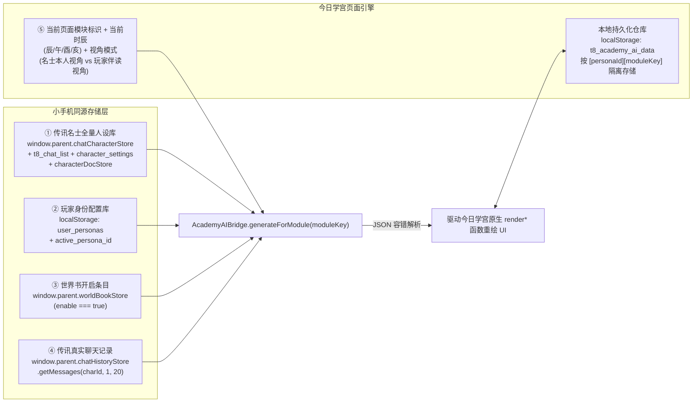

# 「今日学宫」全页面独立 AI 按钮 × 传讯名士五维深度联动定稿执行策划案 (`implementplan.md`)

> [!IMPORTANT]
> **已锁定定稿配置（1A + 2A + 3A）**
> 1. **维度 1 · 视觉形态（选项 1A · 模块顶栏内嵌胶囊）**：在每个主页面和子功能弹窗的顶部导航栏右侧（或功能卡片右上角）嵌入精致的珊瑚金古风胶囊按钮 **`✨ AI 灵犀`**（生成时变为旋转星芒 `⏳ 灵犀构思中...`），不遮挡任何底部内容，如原生教务功能般自然。
> 2. **维度 2 · 视角响应（选项 2A · 名士主视角 + 玩家伴读双响应）**：
>    - **切换到名士分身时**：点击页面 `✨ AI 灵犀` 按钮，直接生成**该名士本人**的成绩单、选课单、请假条、借书单、符牒轨迹、斋舍状态与学宫圈动态；
>    - **保持在玩家（广陵王）分身时**：胶囊旁配备轻量级**「伴读名士选择器」**（可快速切换任意一位传讯名士），点击 `✨ AI 灵犀` 按钮生成**他与你的同窗伴读互动**（如他在你的成绩单/请假条上留批注、为你占空教室座位、在学宫圈发与你有关的动态）。
> 3. **维度 3 · 数据持久化（选项 3A · 按名士独立持久化）**：每位名士通过 AI 按钮生成的各页面数据自动保存在 `localStorage`（`t8_academy_ai_data`），下次打开或来回切换分身均自动恢复、绝不丢失，且随时可再次点击 `✨ AI 灵犀` 刷新重 Roll。

---

## 一、五维全息上下文采集架构（`AcademyAIBridge` 2.0 升级）

每次在任意页面点击 **`✨ AI 灵犀`** 按钮时，`AcademyAIBridge` 将实时汇总以下 **5 大维度** 的真实数据构建 Prompt：



### 1. 深度读取「传讯」中添加的所有名士与聊天记录
- **名士列表与 6 维配置读取（`loadFullCharactersFromPhone`）**：
  - 优先调用 `window.parent.chatCharacterStore.getAll()`（若在独立窗口则直接连接同源 IndexedDB `ChatCharacterDB` / `chatCharacterStore`），合并 `localStorage.getItem('t8_chat_list')` 与 `localStorage.getItem('character_settings')`，并拉取 `window.parent.characterDocStore.getEnabledDocContext(charId)`。
  - 完整提取 6 维核心属性：**① 角色姓名和 ID、② MBTI 性格类型、③ 星座、④ 语言风格与专属口癖、⑤ 性格特点、⑥ 个人背景**。
  - **支持任意新增角色**：用户在「传讯」里新建的任何名士/OC角色都会自动同步至今日学宫右上角「切换分身」抽屉，以及玩家视角下的「伴读名士选择器」中。
- **传讯聊天记录读取（`getRecentChatHistory(charId, charName)`）**：
  - 调用 `window.parent.chatHistoryStore.getMessages(charId, 1, 20)`（及独立窗口 IndexedDB 兜底），提取用户与该名士最近的 **15~20 条传讯对话文本**（自动过滤纯图片 Base64），让名士在今日学宫生成的每一条内容都带着刚聊完天的鲜活记忆！

---

## 二、全站 15 个页面独立 `✨ AI 灵犀` 胶囊按钮布局与生成规范

### 1. 胶囊按钮视觉与双视角交互设计（选项 1A + 2A）
在每个页面/子模块顶栏右侧（或核心卡片标题栏右侧）挂载统一的珊瑚金古风内嵌胶囊组件 `.academy-ai-capsule-bar`：
- **当处于「名士分身」视角（如已切换为刘辩 / 傅融 / 传讯新增名士）**：
  - 显示：`[✨ AI 灵犀 · 生成刘辩手笔]`
  - 点击效果：以该名士第一人称视角，结合五维上下文生成当前页面的专属数据并直接写入页面列表/卡片。
- **当处于「玩家主控（广陵王）」视角**：
  - 显示：`[伴读：▾ 傅融] [✨ AI 灵犀 · 同窗互动]`（点击左侧小胶囊可在下拉菜单中秒切任意一位传讯名士作为当前伴读对象）
  - 点击效果：生成该伴读名士在当前页面与你的同窗互动（如为你占座、批注你的课业、与你同乘马车、在学宫圈发与你有关的帖子）及顶部专属「名士伴读手札」横幅！

---

### 2. 各页面 AI 生成内容与原生数据结构映射表

| 序号 | 页面 / 模块名称 | 按钮挂载位置 | 原生数据变量 & 渲染函数 | 名士主视角生成内容（切换为名士时） | 玩家伴读视角生成内容（广陵王视角时） |
| :--- | :--- | :--- | :--- | :--- | :--- |
| **1** | **校园资讯（首页）** | `#page-campus` 分类标签栏右侧 | `feedData` + `renderFeed()` | 生成 2 条以该名士为主角的太学头条快讯（结合近期传讯话题）插入资讯流顶部 | 生成 2 条该名士在太学与你偶遇/为你解围的校园轶事快讯 |
| **2** | **学宫圈（动态）** | `#page-academy` 热门/最新 Tab 右侧 | `academyPosts` + `loadAcademyPosts()` | 该名士围绕近期传讯聊天内容发一条学宫圈动态（含话题、定位及 2 条同窗评论） | 该名士发布一条暗戳戳提及你（或艾特你）的学宫圈动态 |
| **3** | **讯息处（私聊）** | `#page-message` 顶栏 & `#chatModal` 输入栏旁 | `chatRecords` + `openDualPerspectiveChat()` | 生成太学博士/同窗发给该名士的校园事务传书 | 该名士结合刚才传讯聊过的话题，主动给你发来一条太学私信邀约 |
| **4** | **个人中心（我的）** | `#page-mine` 个人名片卡右上角 | `personasData` + `mineBillsData` + `renderMineAll()` | 生成符合该名士人设的太学院系头衔、状态签名，以及 3 条极具人设特色的太学消费账单 | 该名士往你的太学一卡通里悄悄充了一笔钱/塞了张消费附言字条，写入 `mineBillsData` |
| **5** | **考课成绩单** | `#transcriptModal` 顶栏右侧 | `kkExamsData` + `kkNoticesData` + `renderExamBoardAll()` | 生成该名士本人的 3 门太学考课科目、考场、分数/状态与夫子批语（如偏科神还原） | 该名士翻看你的考课安排后，在考务公告栏留下一条专属押题/考前叮嘱 |
| **6** | **太学选课中心** | `#courseSelectionModal` 顶栏右侧 | `csCourseData` + `renderCourseSelectionList()` | 生成该名士最感兴趣的 2 门太学课程（含授课先生、课余量、以及他选课的私心简介） | 该名士为你推荐并联名锁定了 2 门能与他同桌共读的选修课 |
| **7** | **请假离校系统** | `#leaveSchoolModal` 顶栏右侧 | 请假表单 DOM + 请假历史记录 | 自动用该名士的口癖填好一张离校请假条（含请假类型、目的地、离谱又符合人设的事由） | 该名士作为担保人/同行人，替你拟好一份带他专属批注的出游请假申请 |
| **8** | **兰台藏书阁** | `#ancientBookModal` 顶栏右侧 | `abBorrowListData` + `abHotBooksData` + `renderAncientBookAll()` | 生成该名士当前在借的 2 本古籍，并在热门典籍中附上他的 독서批注 | 该名士替你借好 2 本你需要的古籍，夹着他亲手写的传讯回音书签放入在借列表 |
| **9** | **宿管系统（万舍）** | `#dormSystemModal` 顶栏右侧 | `dmBedsData` + `dmOrdersData` + `renderDormSystemAll()` | 生成该名士在斋舍的起居状态、床铺陈设描述，以及 1 条极具性格特色的斋舍报修单 | 该名士来万舍找你/帮你检查斋舍门窗水电后留下的宿管报修与留言记录 |
| **10** | **查看空教室** | `#emptyRoomModal` 顶栏右侧 | `erRoomsData` + `renderEmptyRoomAll()` | 生成该名士常去的自习斋室状态与他留下的研习笔记标记 | 该名士在某间空教室为你占好绝佳座位（桌上备好点心/茶水），置顶显示在教室列表中 |
| **11** | **辟雍马车时刻** | `#carriageSystemModal` 顶栏右侧 | `mcRoutesData` + `renderCarriageSystemAll()` | 生成该名士在太学班车路线上的乘车偏好与行程动态 | 该名士正在某条马车专线上占好靠窗双人座等你同乘，更新至路线状态卡片 |
| **12** | **通行符牒** | `#passTokenModal` 顶栏右侧 | `fdUseRecordsData` + `renderPassTokenAll()` | 生成该名士今日刷腰牌出入太学各处的 3 条行程轨迹（处处透出他的日常习惯与对你的关注） | 生成该名士今日与你同行刷卡出入藏书阁/常满仓的并肩核验记录 |
| **13** | **夫子评教系统** | `#courseEvalModal` 顶栏右侧 | `pjCoursesData` + `renderCourseEvalAll()` | 生成该名士对太学授课夫子的犀利/温雅评教打分与评语 | 该名士陪你一起评教，在评教栏留下他对该课程的独到见解 |
| **14** | **洛南社团雅集** | `#clubActivityModal` 顶栏右侧 | `stActivitiesData` + `renderClubActivityAll()` | 该名士以社长/特邀嘉宾身份发起一场符合他志趣的太学社团雅集活动卡片 | 该名士专门为你筹办了一场双人/小众社团雅集并向你发出邀请卡片 |
| **15** | **学宫问卷 / 心理团辅** | `#surveyListModal` / `#groupCounselingModal` 顶栏右侧 | `wjSurveysData` / `groupActivities` | 生成该名士发起的趣味太学问卷或团辅主题活动 | 生成该名士填完关于你的默契问卷记录或邀你报名的团辅活动 |

---

## 三、本地持久化方案（选项 3A：`t8_academy_ai_data`）

1. **存储结构**：
   ```json
   {
     "companionCharId": "furong",
     "personas": {
       "char_liubian": {
         "campus": { "generatedAt": 1794305000000, "bannerNote": "...", "items": [...] },
         "transcript": { "generatedAt": 1794305010000, "bannerNote": "...", "items": [...] },
         "leave": { "reason": "...", "dest": "...", "type": "..." }
       },
       "guangling": {
         "campus_furong": { "generatedAt": 1794305020000, "bannerNote": "...", "items": [...] }
       }
     }
   }
   ```
2. **生命周期闭环**：
   - **页面加载 / 切换分身时（`switchPersona`）**：自动检查 `t8_academy_ai_data` 中是否有该分身已生成的各模块 AI 数据；若有，立即恢复并渲染到对应模块列表，同时在模块顶部展示**「📜 名士灵犀手札（已保存 · 点击 ✨ AI 灵犀 可重Roll）」**。
   - **点击 `✨ AI 灵犀` 按钮时**：请求大模型生成最新 JSON 数据 -> 覆盖更新当前分身在该模块的缓存 -> 写入 `localStorage.setItem('t8_academy_ai_data', ...)` -> 立即调用该模块的 `render*()` 函数无刷新重绘界面。

---

## 四、具体代码改动文件与步骤清单

| 步骤 | 目标文件 | 改动类型 | 具体实现内容 |
| :--- | :--- | :--- | :--- |
| **Step 1** | [今日学宫.html](file:///c:/Users/Emily/Desktop/2026-10代号鸢/网页游戏/备份文件/Ano-phone（试行）/试验机1%20-%20表情包活人感强化%20-%20副本/今日学宫.html) | 升级桥接器 | 1. 升级 `getCharactersFromPhone` 为异步深度读取函数 `syncCharactersDeepFromPhone()`，打通 `window.parent.chatCharacterStore`、`t8_chat_list`、`character_settings` 与 `characterDocStore`，确保用户在「传讯」中添加的**所有自定义名士**100% 同步进分身列表。<br/>2. 新增 `getRecentChatHistoryFromPhone(charId, charName)`，从 `window.parent.chatHistoryStore.getMessages` 读取最近 15~20 条传讯聊天记录。<br/>3. 注入珊瑚金古风胶囊样式 `.academy-ai-capsule` 及名士手札横幅样式 `.academy-ai-note-banner`。<br/>4. 自动在 15 个主页面/子功能弹窗的顶栏右侧挂载独立 `✨ AI 灵犀` 胶囊按钮（及玩家视角下的伴读名士快速选择器）。<br/>5. 实现 `generateModuleAIContent(moduleKey)` 与 `t8_academy_ai_data` 按名士持久化保存与恢复逻辑。 |
| **Step 2** | [Milvus/academy_app.js](file:///c:/Users/Emily/Desktop/2026-10代号鸢/网页游戏/备份文件/Ano-phone（试行）/试验机1%20-%20表情包活人感强化%20-%20副本/Milvus/academy_app.js) | 增强同步 | 在点击顶栏「🔄 同步」或打开「今日学宫」时，触发 `syncCharactersDeepFromPhone()`，实时同步传讯最新添加的名士与最新聊天记录。 |

---

## 五、验证计划
1. **传讯自定义名士同步验证**：在小手机「传讯」中添加/修改任意名士，打开「今日学宫」右上角「切换分身」，验证该名士及完整 6 维配置已同步出现并可一键切换。
2. **全页面独立 AI 按钮验证**：在校园首页、学宫圈、考课成绩单、选课中心、请假离校、藏书阁、宿管、空教室、马车、通行符牒等页面点击顶栏右侧 `✨ AI 灵犀`，验证生成内容严格遵循「6维角色人设 + 玩家身份配置 + 开启的世界书 + 传讯近期聊天记录」。
3. **双视角与持久化验证**：在「名士分身」与「广陵王（玩家伴读）」视角间来回切换，并刷新页面，验证 `t8_academy_ai_data` 持久化生效、数据不丢失。
